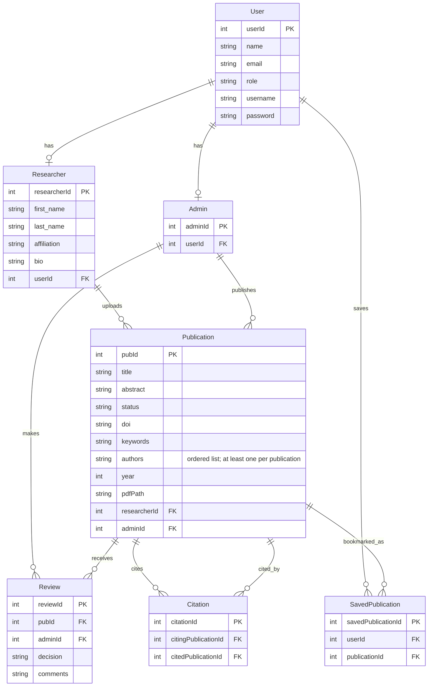

<!-- student-build:skill-integrity
status: pass
root: e84cd692d0b85eefe546385661958c27d07e8be6c5176a82012f68ccff5c8beb
expected_root: e84cd692d0b85eefe546385661958c27d07e8be6c5176a82012f68ccff5c8beb
mismatches: none
-->

# COMP 3613 Assignment 1

Draft this file with the Guide. **Update it after every phase milestone** before you pause. The use-case diagram is a UML PNG at `docs/diagrams/use-case.png`, linked from this file as `diagrams/use-case.png` (path relative to `docs/report.md`). The model diagram is Mermaid. **Embed wireframe images** as `wireframes/<file>` (files live in `docs/wireframes/`).

Do not put your student ID in this file if you will commit it. The PDF cover adds your name and ID at export time.

## Assigned project

Research Platform

## Three workflows

### 1.
Search Publications (User)

### 2.
Upload Paper (Researcher)

### 3.
Review Paper (Admin)

## Use case diagram

Assumption: a public user can browse the publication list without login, while full paper details and authenticated actions require login. Researcher and admin workflows include login before they can upload or review.

Phase 2 decision: the student selected separate use cases and clarified that browsing the paper list is public, while interacting with full content requires login; researchers and admins must be logged in for their workflows.

## Model diagram

Phase 5 revision: role profiles now belong to user accounts, publications belong to researchers, and review decisions are stored once on Review records.

The student named User, Publication, Admin, and Researcher with their initial properties, then confirmed the proposed account/profile and researcher/publication and admin/review relationships.

## Wireframes

<!-- student-build:wireframe-coverage
use_case: Search Publications (User)
image: docs/wireframes/COMP3613.png
covered: yes
-->

<!-- student-build:wireframe-coverage
use_case: Upload Paper (Researcher)
image: docs/wireframes/COMP3613(1).png
covered: yes
-->

<!-- student-build:wireframe-coverage
use_case: Review Paper (Admin)
image: docs/wireframes/COMP3613(1).png
covered: yes
-->

The wireframes show the public browse flow, researcher upload flow, and admin review decision flow.

### Review workflow outcome

After deciding, the admin returns to the review queue and sees confirmation. An approved paper receives `approved` status and appears in the public browseable archive. A rejected paper receives `rejected` status, remains visible to its researcher along with the deciding admin, and is not shown to regular users.

### COMP3613(1)

.png)

### Reader dashboard

### COMP3613(1)

.png)

## Theming

The Scholar's Archive: editorial and archival. The student approved the alternate reference's dramatic estate mood: charcoal `#100B10`, wine-black `#1B1118`, oxblood `#720D20`, ivory `#F0E7DF`, and antique brass `#C4A06C`. Cormorant Garamond remains the display typeface and Inter remains the body/navigation typeface. The existing library image is retained and framed with deeper crimson overlays; catalogue, paper detail, reader, and editorial surfaces use layered charcoal and wine tones. The student said the finished site felt cohesive and eye-catching.

## Implementation notes

One named workflow at a time. Include verify notes and polish / model revisions (Phase 5). Do not treat the first build as final. Phase 5 model alignment: `userId` maps to the starter `User.id`, `researcherId`/`adminId`/`pubId`/`reviewId` map to each SQLModel `id`, Researcher uses `first_name`, `last_name`, `affiliation`, and `bio`, review attributes live only on `Review`, Admin accounts act as Publishers, and citations link one Publication to another. Author, Citation, and AuthoredPublication repository imports from an earlier draft were not carried over as separate entities; Citation is the publication-to-publication link table.

Polish verification: locally confirmed that the paper submission form is available to researcher accounts only; non-researcher accounts do not see it.

Dashboard polish: regular users now receive an editorial reading-room dashboard with library imagery and prominent title/abstract search, while researcher accounts retain the submissions dashboard and upload form. The student requested further appearance refinements and approved the resulting whole-site visual direction; no separate functional dashboard-flow verification is recorded.

Reader dashboard wireframe decisions: implement Dashboard and Publications first; Feed, Updates, and Settings are deferred. Readers want independent saved-paper, saved-citation, saved-reference, and saved-author lists, populated by Save/Remove controls beside items. Saved citations are papers in a paper's “Cited by” section; saved references are papers in its “References” section; saved authors are Researcher profiles. Weekly screen time counts only while a paper tab is visible, and favorite author is based on paper opens. The first implementation slice is saving a publication.

Saved Publication implementation: the `SavedPublication` entity has user/publication foreign keys and a unique pair constraint. Reader accounts can save or remove approved papers from the catalogue, detail page, and saved-paper list; the dashboard lists saved papers. The save action is restricted to reader accounts. The student confirmed that saved papers remain saved and removed papers remain removed. Saved citations, references, authors, and weekly activity remain deferred.

Architecture explanation: the student explained that the save route handles the request and injects the user/session before delegating; the service enforces the approved-publication rule; and the repository alone reads, inserts/deletes, and commits the saved-publication row. They connected this separation to the assignment's route → service → repository layering.

Review workflow implementation: admin decisions set publication status to `approved` or `rejected`, and the review record stores the deciding admin. Researchers see their own submissions and their status; public catalogue queries include approved papers only. Rejected submissions now show the deciding admin to their researcher, while remaining hidden from regular users.

Author-name revision: each Publication stores an ordered list of author names, separate from the submitting Researcher. The submission form accepts one author name per line and requires at least one; author names appear in researcher, admin, catalogue, saved-paper, and publication-detail views. Existing database rows are backfilled from the linked Researcher profile, and seeded publications receive a researcher name. The student reported that the author and reviewer details appeared as expected when tested.

Landing-page polish: the student disliked both the oversized tilted “SA” cover and a horizontal scroll-card reel. After rejecting the phrase and then the framed-photo version, the hero now uses the library photograph as a full-width background behind a centered search-and-discovery layout, with a dark oxblood overlay for readable contrast.

Navigation polish: a shared public-site menu now links Home and Publications everywhere, and shows the signed-in user's Dashboard and account action when available. Authenticated dashboards retain their sidebar and now link to Publications for each role. The student verified that the menu works across pages.

Appearance polish: kept the dark-academia palette and strengthened visual hierarchy with a wider split reading-room hero, layered surfaces, publication and saved-paper cards, clearer metadata badges, refined paper-detail sections, responsive spacing, and visible keyboard focus states. The student confirmed the updated appearance feels better.

Whole-site visual polish: following the student's estate-style reference, the landing page now has a photographic editorial hero, CSS-drawn archive cover, manifesto, three archive workflow panels, and a collection call-to-action. Sign-in and registration use a matching split editorial layout; catalogue, paper detail, and authenticated screens share the same crimson/charcoal/ivory/brass finish. The student verified that the site feels cohesive and eye-catching. Changes remain uncommitted.

<!-- student-build:code-check
workflow: Save Publication (User)
form: choice
layer: other
architecture_ok: yes
implement_confidence: 0.45
passed: yes
note: Selected separate tables for the four independent saved collections.
-->

<!-- student-build:code-check
workflow: Save Publication (User)
form: mcq
layer: repository
architecture_ok: no
implement_confidence: 0.45
passed: no
note: Chose repository for coordinating whether to insert or remove a saved item; service should coordinate the application action.
-->

<!-- student-build:code-check
workflow: Save Publication (User)
form: snippet
layer: model
architecture_ok: yes
implement_confidence: 0.35
passed: yes
note: Added SavedPublication user/publication foreign keys and uniqueness constraint after scaffold guidance.
-->

<!-- student-build:code-check
workflow: Upload Paper (Researcher)
form: choice
layer: other
architecture_ok: yes
implement_confidence: 0.80
passed: yes
note: Chose author names separate from submitter and confirmed entered ordering should be preserved.
-->

<!-- student-build:code-check
workflow: Upload Paper (Researcher)
form: snippet
layer: model
architecture_ok: yes
implement_confidence: 0.80
passed: yes
note: Added an ordered JSON-backed authors field to Publication.
-->

<!-- student-build:code-check
workflow: Upload Paper (Researcher)
form: snippet
layer: router
architecture_ok: yes
implement_confidence: 0.80
passed: yes
note: Bound author names from the submission form and delegated them through PublicationService without persistence in the route.
-->

<!-- student-build:code-check
workflow: Upload Paper (Researcher)
form: mcq
layer: service
architecture_ok: yes
implement_confidence: 0.80
passed: yes
note: Identified the service as the layer deciding whether a submission with no author names is rejected.
-->

<!-- student-build:code-check
workflow: Save Publication (User)
form: snippet
layer: repository
architecture_ok: no
implement_confidence: 0.25
passed: partial
note: Persistence toggle was attempted, but the first edit misplaced route code and duplicated the repository class; final structure was corrected.
-->

<!-- student-build:code-check
workflow: Save Publication (User)
form: snippet
layer: service
architecture_ok: yes
implement_confidence: 0.25
passed: partial
note: Service delegated through the publication repository, but an incorrect repository attribute needed correction.
-->

<!-- student-build:code-check
workflow: Save Publication (User)
form: snippet
layer: router
architecture_ok: yes
implement_confidence: 0.3
passed: yes
note: Thin POST handler binds the authenticated reader and publication, calls PublicationService, and redirects to the detail page.
-->

## Deployed app

Phase 6. Deployed to Render with the Postgres database. The public landing page loads, `GET /health` returns `{"ok":true}`, and a student-provided screenshot shows the signed-in Publications page with 20 approved publications. This confirms the deployed catalogue is reachable in an authenticated session and displays the expected approved-paper count. The screenshot does not establish the total number of records or citation links in the live database.

https://thescholararchive.onrender.com/

## Logins

The application has three roles: regular user, researcher, and admin reviewer/publisher. `python manage.py init` seeds these marker accounts:

- bob / bobpass — regular user
- researcher01 through researcher10 / researchpass — researcher accounts; researcher01 is the primary upload demo
- admin / adminpass — admin reviewer and publisher
- publisher01 through publisher11 / publisherpass — additional admin publisher accounts

## YouTube URL

## Session transcripts

Filled when the Guide builds the report: the agent writes chat markdown into `docs/transcripts/`; `python manage.py report` packages them.

Guide packaged **3** chat(s) in `docs/transcripts/` (and `docs/transcripts.zip`).

Index: [docs/transcripts/INDEX.md](transcripts/INDEX.md)

- [`deployment-session`](transcripts/deployment-session.md)
- [`design-session`](transcripts/design-session.md)
- [`guide-session`](transcripts/guide-session.md)

## Competency (student-judge)

Filled by Guide from the student-judge run when this report was built.

**Judged at:** 2026-10-10T15:30:08-04:00
**Student / session:** Research Platform — Application deployment (Copilot CLI)
**Artifact:** Native Copilot chat sources `docs/transcripts/chat1.json` and `docs/chat2.json`, readable transcripts in `docs/transcripts/`, current report / diagrams / wireframes, and follow-up evidence in this conversation
**Evidence pass:** Re-read both JSON chat records, the current deployment/polish chat and follow-ups, current report, relevant routes/services/repositories/models/templates, diagrams, and wireframes; prior scorecard ignored.
**Phase 6 evidence update (2026-10-10T17:32:12-04:00):** Student-provided screenshot shows the signed-in Publications page with 20 approved publications. In combination with the Render URL and health-check evidence, this satisfies the deployment gate; it does not verify the other 10 publication statuses or citation-link total.
**Phases in evidence:** 1–6 (COMP 3613; Phase 5 polish, Phase 6 deploy; never generic 0–5)

### Totals
| | Count / value |
|--|--|
| Metrics on rubric | 12 (M1–M12) |
| N/A (excluded) | 0 |
| Metrics scored | 12 |
| Scoreable max | 48 |
| Awarded total | 44 / 48 |
| **Overall (avg of scored)** | **3.67 / 4** |
| Impression mark | 18 / 20 |

## Scorecard

| ID | Metric | Score / 4 | In avg | Evidence |
|----|--------|----------:|:------:|----------|
| M1 | Phase discipline | 3 | yes | The student initially asked to deploy, while the Guide flagged unresolved polish and a review-flow question; the student then continued with role-specific UX and multiple rounds of visual polish. |
| M2 | Problem framing | 3 | yes | The student named “search publications (user), upload paper (researcher), review paper (admin),” supplied entities/properties, clarified public browsing versus login for full content, and confirmed the proposed relationships. Their first Phase 2 answer was only “separate,” leaving some shared-use-case reasoning implicit. |
| M3 | Decision ownership | 4 | yes | The student named “search publications (user), upload paper (researcher), review paper (admin),” chose the reader scope and four independent saved lists, and specified rejected-versus-approved visibility in their own words. |
| M4 | Artefact-before-code | 3 | yes | The student clarified the post-review outcome and the code follows most of it: status is updated, reviewer is persisted, and only approved records are publicly browsable. The researcher UI shows status but does not currently display the deciding admin, so fidelity is incomplete. |
| M5 | Verification habit | 4 | yes | The student confirmed, “everything is working as it oat to. the saved papers remain saved or removed,” in addition to earlier local verification of researcher-only submissions and navigation. |
| M6 | Assignment fit | 3 | yes | The model and final save route use the intended layers. The first repository/service snippet attempts needed structural and member-name corrections, but the final route is thin and calls the service. |
| M7 | Slice explanation | 4 | yes | The student explained the save layers and stated, “The repository is the only layer that performs the database change,” with the service enforcing approval and the route delegating. |
| M8 | Prompt quality | 4 | yes | The student gave a phase-labeled prompt pattern with an observed test result, a specific mismatch, and a direct fix request: “Phase 5 save workflow, I tested saving a paper as bob and saw the redirect work but the button still says Save, please fix the label.” |
| M9 | Response to pushback | 4 | yes | After saying, “this dont look appealing,” the student continued steering visual refinements and later said the result was “cohesive and eye-catching.” |
| M10 | Integrity | 4 | yes | No paste-back or transcript-gaming flags were found; `docs/report.md` records course-skill integrity as pass. |
| M11 | Provenance continuity | 4 | yes | The two JSON chats and later polish conversation trace the same archive from early search/upload and deployment through the named workflows, access rules, model, wireframes, implementation, and visual refinements. The student said, “ensure the models are implemented as spec in the erd.” |
| M12 | Sincerity trajectory | 4 | yes | No suspicion round was needed. The student consistently steered the same project in their own words, including “i would like to see this” and “what about this theme?” |

## Strengths
- The student repeatedly identified concrete role and visual mismatches, then continued refining rather than accepting the first appearance pass.
- The wireframe-driven reader scope and four independent saved-list decision were carried through to the model and implementation notes.
- The student attempted both required model and route snippets. The final route is architecture-respecting; no inline SQL route was accepted.
- The student accurately explained why persistence is kept out of the route and how the service and repository split business rules from database work.
- The student demonstrated strong prompt construction by labeling the phase/workflow, reporting an observed behavior, naming the mismatch, and requesting a targeted fix.
- The student clarified the review outcome: approval publishes the paper; rejection remains private to the researcher and identifies the deciding admin.
- Local verification is documented for researcher-only paper submission and shared navigation, and the student gave direct visual feedback.
- The public Render URL and marker accounts are now present in `docs/report.md`; the earlier judge’s “no public URL” gap is no longer supported.
- The student-provided Phase 6 screenshot shows the deployed Publications page in a signed-in session with 20 approved publications.
- The newly available design chat confirms the student owned the original workflow, access, entity, and relationship decisions, and connects them to the later implementation work.

## Gaps (priority order)
1. The intended rejection view includes the deciding admin, but the current researcher template displays the publication status only. The reviewer identity is stored on the review record but is not rendered in that view.
2. The screenshot confirms 20 approved publications, but does not show whether the live database also contains the 10 under-review publications and the requested 150 citation links.

## Phase gate status
| Phase | Status | Note |
|-------|--------|------|
| 1 | met | `docs/report.md` names Research Platform and three workflows. |
| 2 | met | The student named the workflows, chose separate use cases, and specified public browse versus sign-in for full content and privileged workflows. |
| 3 | met | The student supplied the initial entity/property list and confirmed the User/profile, Researcher/publication, and Admin/publication-review relationships. |
| 4 | met | Wireframes cover the named flows and the student clarified the post-review status, visibility, and destination rules. |
| 5 | partial | Theme and polish were student-steered; saved-paper persistence/removal and researcher-only submission are confirmed. The reviewer identity still needs to be shown in the researcher view to match the clarified workflow. |
| 6 | met | The Render URL and health endpoint are verified, and the student-provided screenshot shows the deployed signed-in Publications page displaying 20 approved records. The unshown under-review and citation totals remain a seed-data verification item, not a deployment-gate blocker. |

## Recommended next practice
- Confirm the live database contains the 10 under-review publications and requested 150 citation links; the screenshot already confirms the 20 approved publications.

## Integrity note
- Clean. No suspicion spiral or external-assist/paste-back signal was found. The skill-integrity marker in `docs/report.md` is `pass`.

## Provenance flags
- Reviewed both provided JSON chats and the later deployment/polish chat.
- Readable Guide summaries were added for the JSON chat evidence; original JSON files remain as source evidence.
- No inline-SQL route violation was found in the saved-publication snippet evidence.

## Sincerity log summary
- Blocks found: 0 | max round: N/A | min/mean/final confidence: N/A | trend: N/A | cleared: yes (no suspicion needed)

## Skips
- Skips: 0/3 used (as recorded in the project report). Skips are not an integrity failure.

## Skill integrity

Course skills are hashed at export and compared to `.agents/skills.lock.json`. Do not edit `.agents/skills/`, `.cursor/skills/`, or `AGENTS.md`.

- Status: **pass**
- Root: `e84cd692d0b85eefe546385661958c27d07e8be6c5176a82012f68ccff5c8beb`
- none
