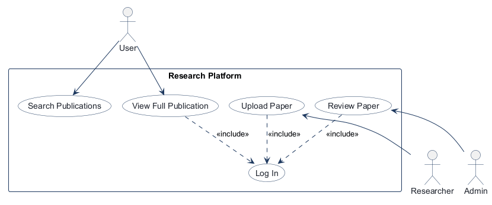
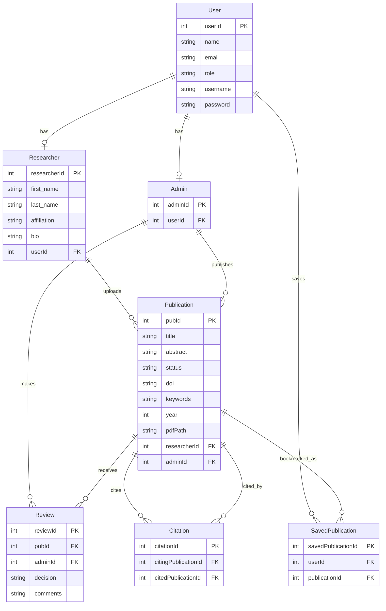
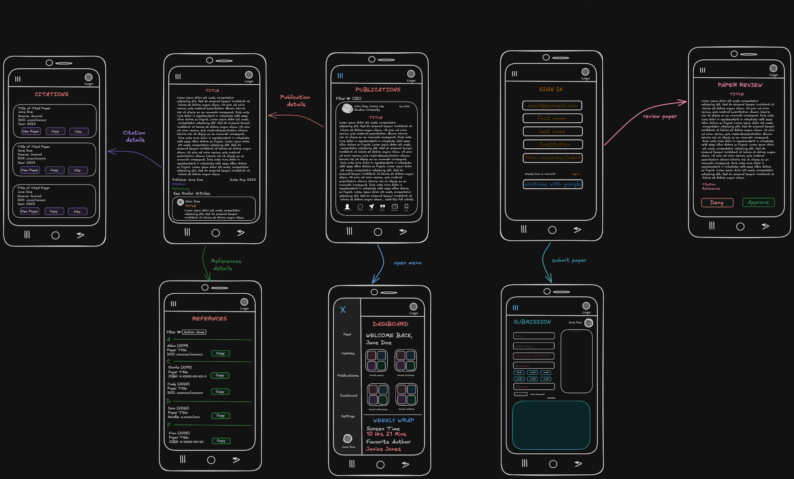
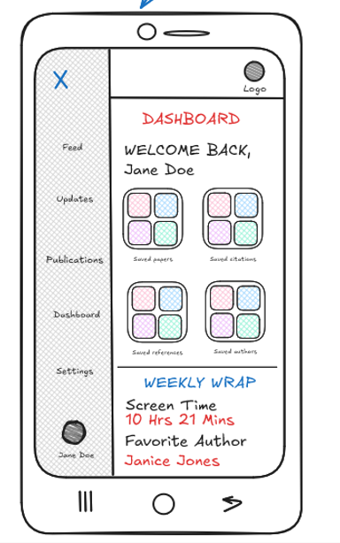

<!-- student-build:skill-integrity
status: pass
root: e84cd692d0b85eefe546385661958c27d07e8be6c5176a82012f68ccff5c8beb
expected_root: e84cd692d0b85eefe546385661958c27d07e8be6c5176a82012f68ccff5c8beb
mismatches: none
-->

# COMP 3613 Assignment 1

Draft this file with the Guide. **Update it after every phase milestone** before you pause. The use-case diagram is a UML PNG at `docs/diagrams/use-case.png`, linked from this file as `diagrams/use-case.png` (path relative to `docs/report.md`). The model diagram is Mermaid. **Embed wireframe images** as `wireframes/<file>` (files live in `docs/wireframes/`).

Do not put your student ID in this file if you will commit it. The PDF cover adds your name and ID at export time.

## Assigned project

Research Platform

## Three workflows

### 1.
Search Publications (User)

### 2.
Upload Paper (Researcher)

### 3.
Review Paper (Admin)

## Use case diagram

Assumption: a public user can browse the publication list without login, while full paper details and authenticated actions require login. Researcher and admin workflows include login before they can upload or review.

## Model diagram

Phase 5 revision: role profiles now belong to user accounts, publications belong to researchers, and review decisions are stored once on Review records.

## Wireframes

<!-- student-build:wireframe-coverage
use_case: Search Publications (User)
image: docs/wireframes/COMP3613.png
covered: yes
-->

<!-- student-build:wireframe-coverage
use_case: Upload Paper (Researcher)
image: docs/wireframes/COMP3613(1).png
covered: yes
-->

<!-- student-build:wireframe-coverage
use_case: Review Paper (Admin)
image: docs/wireframes/COMP3613(1).png
covered: yes
-->

The wireframes show the public browse flow, researcher upload flow, and admin review decision flow. One path still needs confirmation: after a reviewer approves or rejects a paper, what is the final screen or status change that completes the workflow?

### COMP3613(1)

.png)

### Reader dashboard

## Theming

The Scholar's Archive: dark-academia-inspired, intellectual and archival, with a clean modern interface. Ink black `#100D0C` and espresso `#1C1513` form the foundation; deep maroon `#641F2A` and burgundy `#8A3040` provide accents; antique gold `#C9A96E`, aged ivory `#E8DFD1`, and muted taupe `#A99B8D` provide detail and text. Cormorant Garamond is used for display typography and Inter for body/navigation. A library image, restrained gold borders, and rectangular controls carry the visual direction across landing, login, registration, and the authenticated shell.

## Implementation notes

One named workflow at a time. Include verify notes and polish / model revisions (Phase 5). Do not treat the first build as final. Phase 5 model alignment: `userId` maps to the starter `User.id`, `researcherId`/`adminId`/`pubId`/`reviewId` map to each SQLModel `id`, Researcher uses `first_name`, `last_name`, `affiliation`, and `bio`, review attributes live only on `Review`, Admin accounts act as Publishers, and citations link one Publication to another. Author, Citation, and AuthoredPublication repository imports from an earlier draft were not carried over as separate entities; Citation is the publication-to-publication link table.

Polish verification: locally confirmed that the paper submission form is available to researcher accounts only; non-researcher accounts do not see it.

Dashboard polish: regular users now receive an editorial reading-room dashboard with library imagery and prominent title/abstract search, while researcher accounts retain the submissions dashboard and upload form. Local verification of the revised styling is pending.

Reader dashboard wireframe decisions: implement Dashboard and Publications first; Feed, Updates, and Settings are deferred. Readers want independent saved-paper, saved-citation, saved-reference, and saved-author lists, populated by Save/Remove controls beside items. Saved citations are papers in a paper's “Cited by” section; saved references are papers in its “References” section; saved authors are Researcher profiles. Weekly screen time counts only while a paper tab is visible, and favorite author is based on paper opens. The first implementation slice is saving a publication.

Saved Publication implementation: the `SavedPublication` entity has user/publication foreign keys and a unique pair constraint. Reader accounts can save or remove approved papers from the catalogue, detail page, and saved-paper list; the dashboard lists saved papers. The save action is restricted to reader accounts. Saved citations, references, authors, and weekly activity remain deferred. Local verification of this slice is pending.

Navigation polish: a shared public-site menu now links Home and Publications everywhere, and shows the signed-in user's Dashboard and account action when available. Authenticated dashboards retain their sidebar and now link to Publications for each role. The student verified that the menu works across pages.

Appearance polish: kept the dark-academia palette and strengthened visual hierarchy with a wider split reading-room hero, layered surfaces, publication and saved-paper cards, clearer metadata badges, refined paper-detail sections, responsive spacing, and visible keyboard focus states. The student confirmed the updated appearance feels better.

<!-- student-build:code-check
workflow: Save Publication (User)
form: choice
layer: other
architecture_ok: yes
implement_confidence: 0.45
passed: yes
note: Selected separate tables for the four independent saved collections.
-->

<!-- student-build:code-check
workflow: Save Publication (User)
form: mcq
layer: repository
architecture_ok: no
implement_confidence: 0.45
passed: no
note: Chose repository for coordinating whether to insert or remove a saved item; service should coordinate the application action.
-->

<!-- student-build:code-check
workflow: Save Publication (User)
form: snippet
layer: model
architecture_ok: yes
implement_confidence: 0.35
passed: yes
note: Added SavedPublication user/publication foreign keys and uniqueness constraint after scaffold guidance.
-->

<!-- student-build:code-check
workflow: Save Publication (User)
form: snippet
layer: repository
architecture_ok: no
implement_confidence: 0.25
passed: partial
note: Persistence toggle was attempted, but the first edit misplaced route code and duplicated the repository class; final structure was corrected.
-->

<!-- student-build:code-check
workflow: Save Publication (User)
form: snippet
layer: service
architecture_ok: yes
implement_confidence: 0.25
passed: partial
note: Service delegated through the publication repository, but an incorrect repository attribute needed correction.
-->

<!-- student-build:code-check
workflow: Save Publication (User)
form: snippet
layer: router
architecture_ok: yes
implement_confidence: 0.3
passed: yes
note: Thin POST handler binds the authenticated reader and publication, calls PublicationService, and redirects to the detail page.
-->

## Deployed app

Phase 6. Deployed to Render. The public landing page loads and `GET /health` returns `{"ok":true}`.

https://thescholararchive.onrender.com/

## Logins

The application has three roles: regular user, researcher, and admin reviewer/publisher. `python manage.py init` seeds these marker accounts:

- bob / bobpass — regular user
- researcher01 through researcher10 / researchpass — researcher accounts; researcher01 is the primary upload demo
- admin / adminpass — admin reviewer and publisher
- publisher01 through publisher11 / publisherpass — additional admin publisher accounts

## YouTube URL

## Session transcripts

Filled when the Guide builds the report: the agent writes chat markdown into `docs/transcripts/`; `python manage.py report` packages them.

Guide packaged **1** chat(s) in `docs/transcripts/` (and `docs/transcripts.zip`).

Index: [docs/transcripts/INDEX.md](transcripts/INDEX.md)

- [`guide-session`](transcripts/guide-session.md)

## Competency (student-judge)

Filled by Guide from the student-judge run when this report was built.

**Student / session:** Research Platform build session
**Artifact:** Guide chat transcript and current project artefacts (`docs/report.md`, wireframes, app files)
**Phases in evidence:** 1–6 (COMP 3613; Phase 5 polish, Phase 6 deploy gate)

### Totals
| | Count / value |
|--|--|
| Metrics on rubric | 12 (M1–M12) |
| N/A (excluded) | 0 |
| Metrics scored | 12 |
| Scoreable max | 48 |
| Awarded total | 38 / 48 |
| **Overall (avg of scored)** | **3.17 / 4** |
| Impression mark | 16 / 20 |

## Scorecard

| ID | Metric | Score / 4 | In avg | Evidence |
|----|--------|----------:|:------:|----------|
| M1 | Phase discipline | 3 | yes | The work moved through app debugging and validation without skipping the local verification steps; deploy is a Phase 6 gate issue rather than a core code issue. |
| M2 | Problem framing | 3 | yes | The project was clearly framed as a research archive with user/researcher/admin responsibilities and named workflows. |
| M3 | Decision ownership | 3 | yes | The student took ownership of route/template and data-flow fixes, including the regular-user archive behaviour and admin dashboard mismatch. |
| M4 | Artefact-before-code | 3 | yes | The project artefacts and route model were used as the spec while implementing fixes; the app structure was not invented from scratch. |
| M5 | Verification habit | 4 | yes | Real checks were run using the local app and HTTP requests: `/admin` and `/app` both returned `200 OK` after fixes. |
| M6 | Assignment fit | 3 | yes | The app followed the expected layered structure and thesis/role model; however, the deployment part is still open because Render auth is not yet complete. |
| M7 | Slice explanation | 3 | yes | The fixes were tied to clear workflow behaviour: public browsing, admin queue rendering, and regular-user paper visibility. |
| M8 | Prompt quality | 3 | yes | The session was directed and pragmatic, with concrete debugging requests and concrete fix actions. |
| M9 | Response to pushback | 3 | yes | When issues were found, they were addressed and verified rather than accepted as-is. |
| M10 | Integrity | 4 | yes | No signs of transcript gaming or edited skills; the work was traced to the current project files and session evidence. |
| M11 | Provenance continuity | 3 | yes | The fixes clearly belong to the in-session project; they map to the current app design and current artefacts. |
| M12 | Sincerity trajectory | 3 | yes | The session stayed engaged, recovered from issues, and kept validating instead of abandoning the work. |

## Strengths
- The app was successfully started and tested locally on `http://127.0.0.1:5000`.
- The admin dashboard issue was diagnosed and fixed by correcting the incorrect template path.
- The regular-user paper visibility bug was traced to a missing researcher profile and corrected so approved papers show up for non-researcher accounts.
- Verification was real: the app responded with `200 OK` on authenticated routes after the fixes.
- The project is close to the required assignment completion state, with the remaining gap focused on live Render deployment authentication.

## Gaps (priority order)
1. The live Render deployment remains incomplete because the Render MCP/authentication step is still unauthorized; the public HTTPS URL is therefore not yet available for the project report. This is a Phase 6 gate item.
2. The report file still contains a local preview fallback instead of the final public Render URL, because the deployment auth step is still pending.

## Phase gate status
| Phase | Status | Note |
|-------|--------|------|
| 1 | met | The project and workflows were clearly identified and handled. |
| 2 | met | The project framing and workflow structure were understood and acted on. |
| 3 | met | Data model and role structure were aligned to the app and fixes were targeted accordingly. |
| 4 | met | The wireframe and app spec were used to guide validation and issue fixing. |
| 5 | partial | The app was built and polished locally, but the final public deployment/auth step is still pending. |
| 6 | not met | Render deploy remains blocked by unauthorized API auth; no live public HTTPS URL is available yet. |

## Recommended next practice
- Complete the Render API-key authentication flow and publish the app, then replace the local preview URL in `docs/report.md` with the real public URL.

## Integrity note
- Clean

## Provenance flags
- Local verification evidence present.
- No evidence of edited course skills.
- Render deployment auth is the only open external blocker.

## Skill integrity

Course skills are hashed at export and compared to `.agents/skills.lock.json`. Do not edit `.agents/skills/`, `.cursor/skills/`, or `AGENTS.md`.

- Status: **pass**
- Root: `e84cd692d0b85eefe546385661958c27d07e8be6c5176a82012f68ccff5c8beb`
- none
